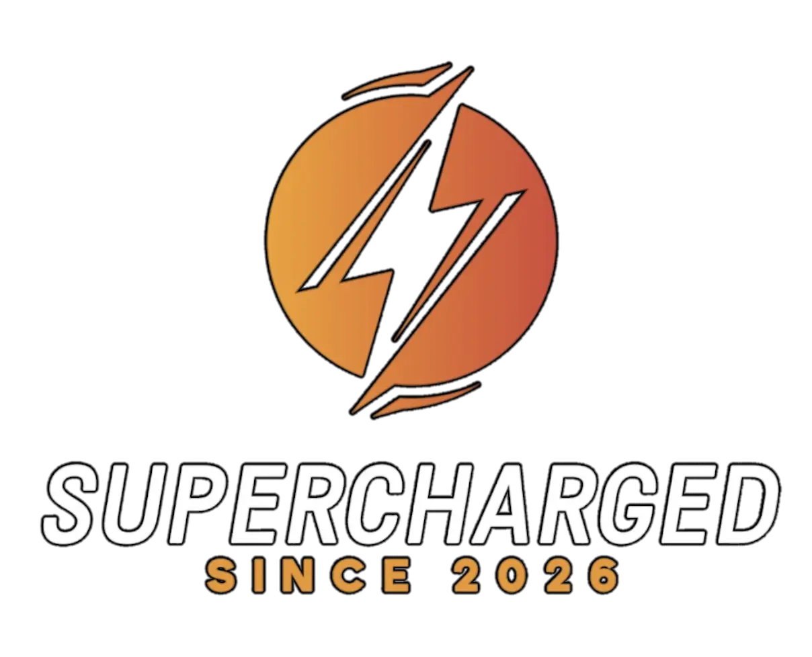

  

<h1 align="center">PROJECT AURA</h1>

<strong>Advanced UV &amp; Risk-prediction Assistant</strong> Developed by <strong>SUPERCHARGED</strong>

<em>Your Health. Your Future. Your AURA.</em>

---

## The idea

**What if your wrist could become your personal health-awareness companion?**

Project AURA is an experimental wearable prototype exploring how UV exposure, vital indicators and timely alerts can be brought together in one easy-to-understand experience. It pairs an ESP32-based wearable with interactive smartwatch and mobile-app digital twins.

AURA is designed to support awareness and encourage informed everyday decisions—not to replace a doctor or provide a medical diagnosis.

## The gap

People who spend long hours outdoors, such as delivery riders, street vendors and construction workers, experience changing sunlight and other conditions throughout the day. AURA explores how a wearable could offer a more personal, on-the-spot reminder to check in with those signals.

The International Labour Organization estimates that at least **2.41 billion workers** are exposed to excessive heat at work each year. [Read the ILO report](https://www.ilo.org/sites/default/files/2024-04/ILO%20OSH%20report%202024%20at%20a%20glance.pdf).

AURA does **not** measure heat stress and cannot replace shade, water, rest, appropriate workplace protections or medical care.

## Key features

| Feature | What AURA explores |
|---|---|
| **UV exposure tracking** | Estimated UV levels and time spent exposed to sunlight. |
| **Vital indicators** | Experimental heart-rate, SpO₂ and sensor-temperature readings. |
| **Skin sensitivity** | Standard and sensitive modes with different UV-related rules and sunscreen reminders. |
| **Composite safety score** | A rule-based demo score bringing several indicators together in one overview. |
| **Wrist and mobile alerts** | On-wrist alerts and connected-dashboard notifications while the page is open. |
| **One-touch interaction** | Touch controls for acknowledging alerts and navigating the wearable. |
| **Standalone edge safety** | Essential alert rules designed to run on the wearable without a constant phone connection. |
| **Wi-Fi and USB serial** | Two-way links between the wearable and compatible dashboard interfaces. |
| **Battery awareness** | An approximate voltage-based battery estimate using a verified resistor divider. |

## Understanding the composite score

The demonstration score starts at **100** and subtracts penalties for estimated UV exposure, sunscreen timing and readings outside configured heart-rate, SpO₂ or temperature thresholds. A further penalty can apply when certain UV and temperature or heart-rate conditions occur together.

| Demo score | Displayed band |
|---|---|
| 80–100 | Optimal |
| 55–79 | Caution |
| 0–54 | High Risk |

If valid heart-rate, SpO₂ or temperature data is missing, the prototype displays **No Data** instead of a score. The score is a demonstration rule set, not a clinically validated measure of personal risk.

## Prototype components

The project is built around an **ESP32-C3 SuperMini**, with an ACEBOTT UV sensor, MAX30102 heart-rate/SpO₂ module, DS18B20 temperature sensor, TTP223R touch sensor, yellow-and-blue OLED, vibration motor and buzzer. A LiPo battery, TP4056 charger, boost converter and switch form the proposed power system.

The TP4056 charges the cell but does **not** report battery percentage. The ESP32 can estimate it from voltage when a suitable, verified resistor divider is installed. The sensor temperature is **not** a measurement of core body temperature.

## Project experience

The website presents AURA's story alongside two interactive digital twins: **Companion** and **Studio**. They can demonstrate scenarios using simulated values. The website's wearable image is an AI-illustrated concept, not a photograph of the physical prototype.

- [Website source](index.html)
- [Companion digital-twin source](demo/companion.html)
- [Studio digital-twin source](demo/studio.html)
- [Prototype kit: firmware, wiring guide and demos](downloads/project-aura-prototype-kit.zip)

Build photographs, a prototype video and supporting project documents will be added when available.

## Project status & safety

The firmware has compiled and the browser demos have been tested with simulated interfaces. **The physical hardware, wiring, sensor readings and alert accuracy have not yet been validated.** UV, SpO₂, temperature, battery and score values are experimental estimates; an unwired UV sensor may not be reliably detected.

AURA is an experimental prototype—not a medical device, a sun-safety guarantee or a substitute for professional advice.

## One team. One vision.

**SUPERCHARGED** is a one-member team with a vision to make technology more personal and everyday awareness more accessible.

Project AURA is inspired by **United Nations Sustainable Development Goal 3: Good Health and Well-Being**. It is an independent project; no UN endorsement is implied.

---

<strong>PROJECT AURA × SUPERCHARGED</strong> <em>Your Health. Your Future. Your AURA.</em>

